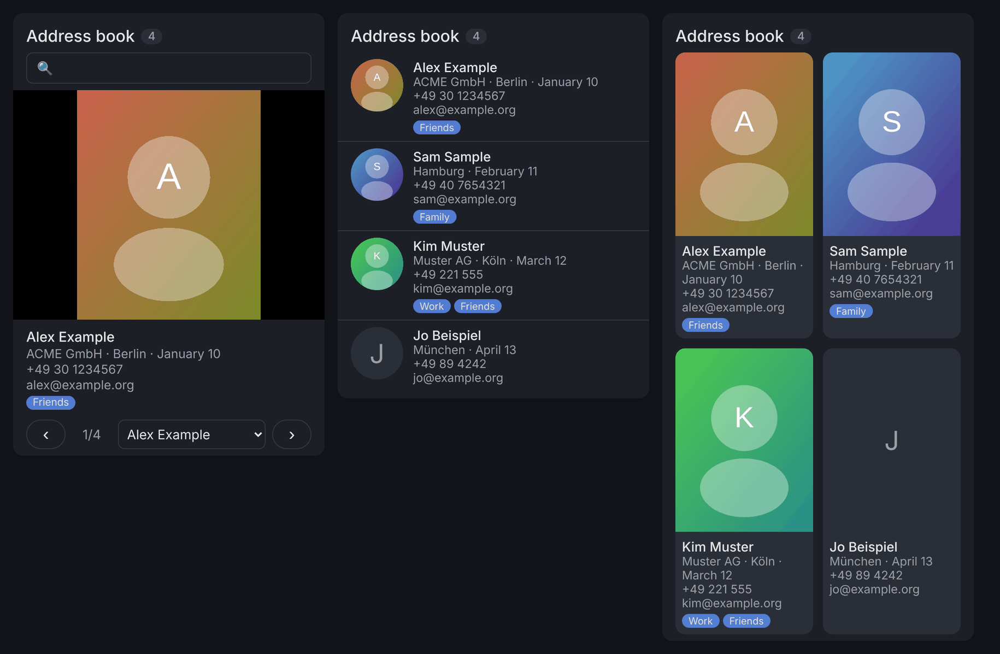

# Profile Gallery Card

A Lovelace card for Home Assistant that shows **profiles, contacts and calendar events with pictures** – as a **list**, a **grid**, or **one card at a time to browse** (arrows, swipe, counter “3/23”, jump list and search). Clicking a picture opens all pictures of the entry full screen. A star (☆) marks a picture as favourite: it is shown first from then on, saved per Home Assistant user, so on every device.



*All names and pictures in the screenshot are made up.*

The card does not depend on one integration: it reads a list from an entity attribute, one entry per entity, the events of a calendar, or the JSON result of a template, and maps fields with a preset or your own mapping.

## Installation

**HACS:** ⋮ → *Custom repositories* → `https://github.com/Schimmelreiter/profile-gallery-card`, type *Dashboard*. Install, then reload the browser.

**Manually:** copy `profile-gallery-card.js` to `<config>/www/` and add the resource `/local/profile-gallery-card.js` (type *JavaScript module*) under *Settings → Dashboards → ⋮ → Resources*.

Then add the card from the card picker (*Profile Gallery Card*) and set it up in the visual editor, or use YAML.

## Options

| Option | Meaning |
|---|---|
| `title` | heading (with the number of entries) |
| `source` | where the entries come from, see below (required) |
| `preset` | field mapping for known data: `google_contacts`, `calendar`, `swinger_companion`, `nutten_scan`, `none` |
| `fields` | your own field mapping, overrides the preset (see below) |
| `mode` | `list` (default), `grid` or `browse` |
| `search` | search field above the entries |
| `jump` | jump list in `browse` mode (default `true`) |
| `columns` | columns in `grid` mode (default 3, on phones 2) |
| `image_height` | picture height in px: in `browse` mode (default 280) and, if set, for the tiles in `grid` mode |
| `image_fit` | `contain` (whole picture, default with `image_height`) or `cover` (fill the tile, cut off) |
| `filter` | only entries whose fields have these values: `{ path: value }` or `{ path: [value1, value2] }` |
| `sort` | field or path to sort by, or `{ by: …, desc: true }` |
| `limit` | at most this many entries |
| `show_text` | show the text in `list` mode (default `true`) |
| `join` | field holding an entity id; that entity's attributes complete the entry (non-empty fields of the entry win) |
| `controls` | entities shown as controls above the gallery: list of rows; a cell is an entity id, `{ entity, name }`, `{ gap: true }` or `{ toggle: entity }` (round on/off button) |
| `controls_from` | the same rows read from an attribute: `{ entity, attribute }` |
| `controls_position` | in `grid` mode the controls are the first tile; `top` puts them above the gallery |
| `controls_icons` | `true` keeps the entity icons in the controls (default: hidden, needs card-mod) |
| `actions` | buttons on each entry that toggle an entity named in a field: `[{ field, icon, icon_on, name }]` |
| `date` | date input on each entry for a `date` entity named in a field: `{ field, when }` (`when`: only while that switch is on) |
| `details` | ⓘ button opening a window with HTML from fields: `{ head, body }`, plus all pictures, actions and the note |
| `note` | editable note in the detail window: `{ field, name, service, data }`; in `data`, `{value}` is the text and `{path}` a field of the entry |
| `styles` | extra CSS for the card and the detail window, e.g. for classes in `html` (`.tabu { color: red; }`); presets with HTML bring their own |
| `empty_text` | text when there are no entries |

### Sources

| `source` | Entries |
|---|---|
| `entity` + `attribute` | the list in this attribute (paths allowed: `data.items`) |
| `entity` alone | the entity itself, with its attributes |
| `entities` | one entry per entity; `*` is allowed: `[sensor.m*_profil]` |
| `calendar` (+ `days`, `past_days`) | events of the next 60 days; a picture address in the description becomes the picture, another link the link |
| `template` | a template that returns a JSON list of objects |

### Fields

Each entry is mapped to this format (version 1): `title`, `subtitle`, `image`, `images`, `videos`, `url`, `text`, `badges`, `lines`, `notice`, `date`, `html`, `id`. `html` (trusted HTML from your own integration) replaces title and subtitle. A badge can be conditional: `{ text, when, is }`. `notice` is a hint line at the top of the entry, above the picture (same condition form, `**bold**` allowed). Videos are played in the full-screen view after the pictures.

A field is a **path** (`name`, `last_meet.club`, `profiles.0.url`, `phones.*.value` for all values of a list) or a **format** with paths in braces: `"{organization} · {city}"`. Parts between ` · ` that are empty disappear. `badges` and `lines` take a list.

```yaml
fields:
  title: name
  subtitle: "{organization} · {city}"
  image: image
  images: gallery            # list of picture addresses
  badges: [groups.*]
  lines: [phones.*.value, emails.*.value]
  url: url
```

## Examples

### Address book (Google Contacts)

With the [Google Contacts integration](https://github.com/Schimmelreiter/ha-google-contacts):

```yaml
type: custom:profile-gallery-card
title: Address book
source:
  entity: sensor.google_contacts_alex_example_org_contacts
  attribute: contacts
preset: google_contacts
mode: browse
search: true
```

Only one label, as a grid:

```yaml
type: custom:profile-gallery-card
title: Friends
source:
  entity: sensor.google_contacts_alex_example_org_contacts
  attribute: contacts
preset: google_contacts
mode: grid
filter:
  groups.0: Friends
```

### Upcoming birthdays

```yaml
type: custom:profile-gallery-card
title: Birthdays
source:
  calendar: calendar.google_contacts_alex_example_org_birthdays
  days: 30
preset: calendar
mode: list
```

### Events with pictures

Any calendar whose events carry a picture address in the description:

```yaml
type: custom:profile-gallery-card
title: Parties
source:
  calendar: calendar.my_events
  days: 90
mode: browse
```

### Anything with a template

```yaml
type: custom:profile-gallery-card
title: Who is home
source:
  template: >
    {{ states.person | map(attribute='attributes') | list | to_json }}
fields:
  title: friendly_name
  image: entity_picture
mode: grid
```

## Item format

The card works on this format internally (`v: 1`). Integrations can deliver it directly; then no mapping is needed (`preset: none`, `fields` with the same names).

| Field | Meaning |
|---|---|
| `id` | stable ID |
| `title`, `subtitle` | name and second line |
| `image`, `images[]` | main picture and all pictures |
| `videos[]` | video addresses (shown after the pictures) |
| `url` | link of the title |
| `text` | longer text |
| `badges[]`, `lines[]` | small labels and extra lines |
| `date` | date (`YYYY-MM-DD`, `--MM-DD`, ISO date-time) |

## License

GPL-3.0
